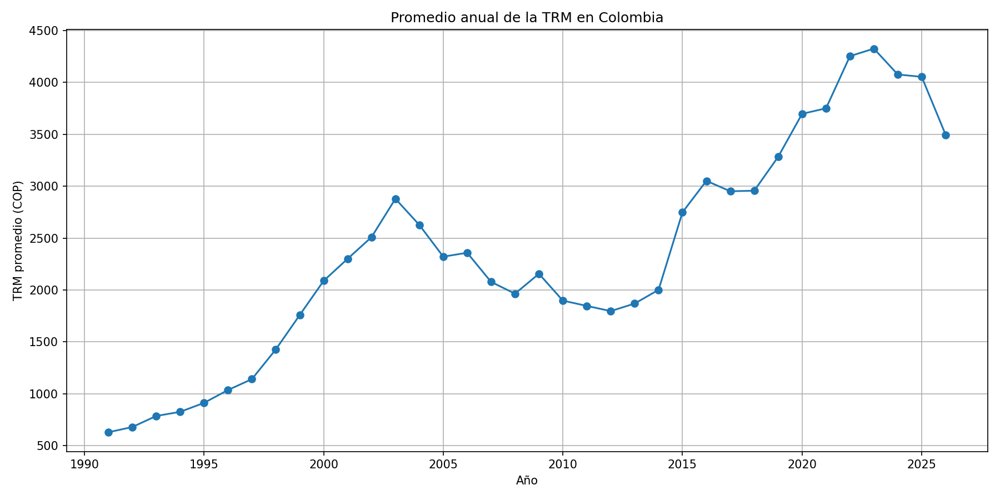

# Tarea 3 - Procesamiento de Datos con Apache Spark

## Descripción

Este proyecto fue desarrollado para la Tarea 3 del curso de Big Data. El objetivo es realizar un análisis de la Tasa Representativa del Mercado (TRM) en Colombia utilizando Apache Spark y Python.

Para el desarrollo se utilizó información histórica de la TRM obtenida desde Datos Abiertos Colombia. Con estos datos se realizaron procesos de carga, limpieza, transformación y análisis exploratorio para identificar el comportamiento de la TRM durante diferentes años.

## Problema seleccionado

El problema consiste en analizar cómo ha cambiado la Tasa Representativa del Mercado en Colombia a través del tiempo.

Por medio del análisis se busca identificar:

- El valor mínimo de la TRM.
- El valor máximo registrado.
- El promedio general.
- El promedio de la TRM por año.
- Los valores más altos registrados en el conjunto de datos.

## Fuente de los datos

El conjunto de datos utilizado corresponde al histórico de la Tasa de Cambio Representativa del Mercado de Colombia.

Fuente: Datos Abiertos Colombia.

Dataset utilizado:

`Tasa de Cambio Representativa del Mercado - Histórico`

## Tecnologías utilizadas

- Apache Spark 3.5.8
- PySpark
- Python 3
- Hadoop HDFS
- Matplotlib
- Ubuntu Server 22.04

## Archivos del proyecto

### batch_analysis.py

Contiene el procesamiento principal realizado con Apache Spark.

El código:

- Carga el archivo desde HDFS.
- Elimina registros con valores faltantes.
- Transforma la columna de fecha.
- Realiza estadísticas generales.
- Obtiene el valor mínimo, máximo y promedio de la TRM.
- Calcula el promedio de la TRM por año.
- Identifica los valores más altos registrados.

### batch_visualization.py

Genera una gráfica con el promedio anual de la TRM utilizando los resultados procesados con Spark.

### trm_promedio_anual.png

Resultado gráfico generado por el análisis.

## Ejecución

Para ejecutar el análisis principal:

```bash
spark-submit batch_analysis.py
```

Para generar la visualización:

```bash
spark-submit batch_visualization.py
```

## Resultado

El procesamiento permitió observar la evolución histórica de la TRM y calcular diferentes estadísticas sobre los datos.

También se generó una gráfica que permite visualizar de una forma más clara cómo ha cambiado el promedio anual de la TRM en Colombia.



## Autor

Sergio Alejandro Sanabria Herreras

Curso: Big Data  
Universidad Nacional Abierta y a Distancia - UNAD
